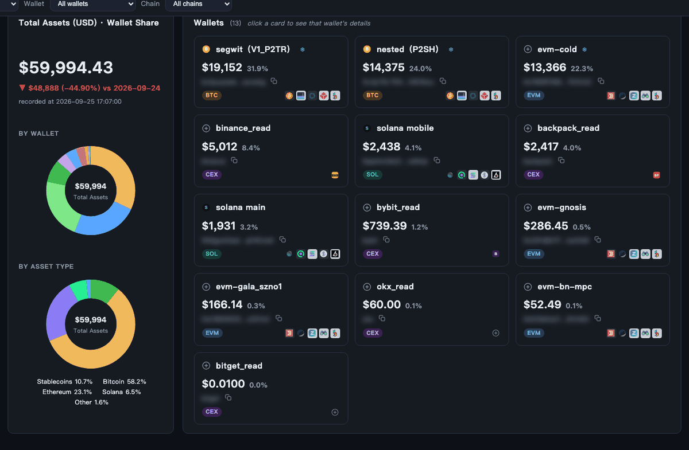
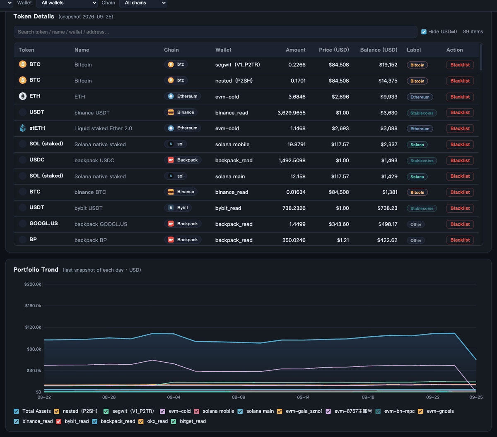
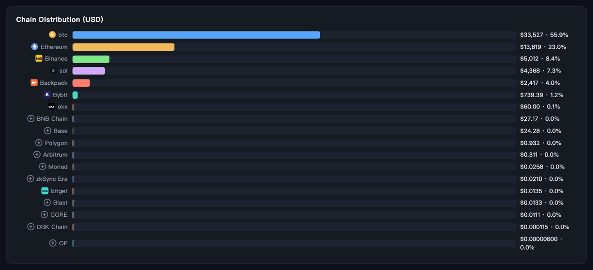
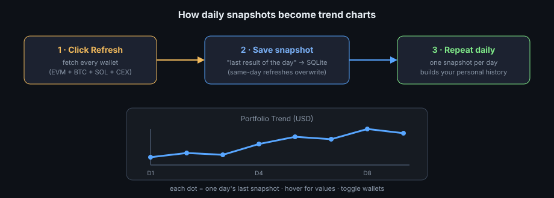
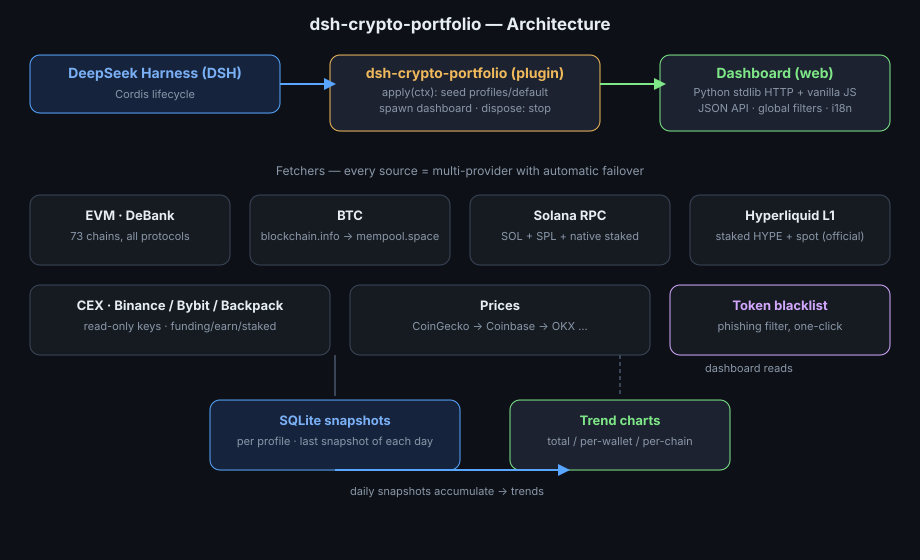

# dsh-crypto-portfolio

[English](README.md) | 中文

免费、100% 自托管的 [DeepSeek Harness](https://github.com/deepseek-ai/deepseek-harness)（DSH）插件：把**链上与 CEX 资产**统一到一张自包含的 Web 仪表盘上。

**依赖** `dsh` `0.1.1-rc.2`（Node `^22.19 || >=24`）· Python 3.9+ · `pip3 install requests pynacl`

```sh
dsh plugin --profile demo add dsh-crypto-portfolio   # npm
dsh --profile demo                                    # 仪表盘 http://127.0.0.1:8080
```

> **孪生项目。** 这张仪表盘是 [SmartFolio Chrome 扩展](https://chromewebstore.google.com/detail/smartfolio/ogiijkjoahbekjnjhnchjefllioelcin)的孪生项目：扩展把同一批钱包放进浏览器工具栏，而这里是跑在你自己机器上的自托管、全链视图。同一个思路，两种外壳——仪表盘是一个 DSH 插件，遵循 DSH 插件规范，因此保留自己的名字。







> 非官方项目，由社区成员独立开发和维护，与 DeepSeek 官方无关。

---

## 为什么写它 / 痛点

我写它是因为痛点是真的疼。

### 一、我的钱散在七个地方，想看个总数要开六个页面

EVM 资产在 DeBank、SOL 和质押在 Solana 链上、BTC 在区块浏览器、还有 Binance / Bybit / Backpack / OKX / Bitget 五个交易所各一套 App。每次想看"我到底有多少钱"，都得打开 DeBank 翻几个链、再去查质押、最后挨个登录三个交易所——手一抖还容易看漏钱包。

**这个插件把这些全拼到一张图上。**

### 二、链上浏览器看不到的"隐形资产"

有些钱是真的看不见：Solana 的原生质押账户（`getParsedStakeAccounts` 会漏）、Hyperliquid L1 的质押 HYPE 和现货、交易所的理财/资金账户——这些都不是普通 SPL/ERC20 代币，普通工具根本读不到。

**这个插件专门把它们挖出来，全部计价进总资产**——包括上面的账户里质押的 12.1 SOL、Hyperliquid 上质押的约 318 枚 HYPE。

### 三、空气币和钓鱼代币把数字搞得虚高

DeBank 会把一堆假代币也列出来，比如 ETHG 这种**价格被操纵的钓鱼币**，一个账户能虚报出 57 万美元。

**一键拉黑**：你点掉的每一笔都会从总额、趋势、历史快照里同步剔除。

### 四、我想知道"上周这时候我到底有多少钱"

没有历史就没有安全感。

**每次刷新自动保存当天最后一次快照**（SQLite，按天去重）；日子久了，就长出一条属于你自己的资产趋势线：



---

## 它做了什么

- **一个 DSH 插件，拉起一个零依赖的 Web 仪表盘。** 没有框架、没有 CDN，Python 标准库 + 原生 JS。
- **覆盖 BTC / EVM / Solana / 狗狗币 / 艾达币 / Hyperliquid L1 / CEX。** DeBank 全 73 条链、BTC 双地址（P2SH + P2TR）、Solana 原生质押、狗狗币（BlockCypher）、艾达币（Koios，支持 stake 地址）、Hyperliquid 官方 API（质押 HYPE + 现货 + 永续权益 + 金库权益）、五个交易所只读 key（Binance / Bybit / Backpack / OKX / Bitget，命名 `<交易所>_read`）；OKX 同时读交易账户与资金账户，Bitget 汇总现货与真实合约账户（跳过 S 开头的模拟盘，避免把「练习钱」算进总资产）。
- **全局筛选。** 分类（BTC / EVM / Solana / 狗狗币 / 艾达币 / CEX）、钱包、网络三个下拉作用于所有面板——总额、钱包占比饼图、趋势、网络分布、代币表一起联动。
- **每个钱包最多 5 个区块浏览器。** 钱包卡片底部是一排浏览器图标：排第一的是本程序实际取数的来源（DeBank · bitaps · Jupiter · Dogechain · Cardanoscan），后面按知名度依次是 Etherscan、mempool.space、Solscan、Blockchair、CExplorer 等。狗狗币只有 3 个、艾达币只有 4 个——这两个生态确实凑不满 5 个可信浏览器。交易所账户没有链上浏览器页面，因此只显示交易所图标。
- **免费 + 付费数据源，显著区分。** EVM 走 DeBank 双 provider：付费 `debank-pro`（标注「付费」，带注册链接）与免费免 key 的 `debank-public` 兜底；CEX 五行（Binance/Bybit/Backpack/OKX/Bitget）常驻显示并带各家「获取 API key」链接（OKX、Bitget 还需填 passphrase）；每个数据源显示最近一次成功时间。
- **多 API 源自动切换。** 每个数据源配了多个 provider（价格：CoinGecko → Binance → Coinbase → OKX；BTC：blockchain.info → mempool.space；Solana RPC 多节点；Hyperliquid 双端点），挂了自动切下一个，并记住最近能用的。
- **定时每日刷新。** 每个 Profile 可设置本地时间自动刷新（服务端守护线程，关闭网页不影响）；设置页显示各数据源最后成功时间。
- **多 Profile 配置隔离。** `default` Profile 内置公开模板钱包（vitalik.eth、创世 BTC、公开 SOL、公开 DOGE、公开 ADA）与空 key；你的私人钱包和 key 放在独立命名的 Profile 里，拥有各自的快照历史。每个 Profile 可重命名（快照随之迁移），并各自维护独立的每日定时刷新时间。
- **资产健康度。** 代币明细表上方一个面板用三张卡片给组合打分——**波动性风险**（稳定币 · 比特币 · 其他，按高波动占比评级）、**集中度**（最大钱包占比，画成带两条阈值刻度的量尺）、**托管安全**（冷 · 热 · 交易所）。每一行都同时给出余额和占比，未通过的项各配一句人话建议。三条阈值都能在设置页里改（按 Profile 保存、带校验，托管安全那对是反向的），数据取自同一份已过滤黑名单的快照，因此永远和上面的总额一致。在设置里把钱包标成「冷钱包」，托管安全那项**立刻**跟着变（冷热以当前钱包列表为准，快照里的值只作为已删除钱包的兜底）。
- **手动协议持仓。** 不是每个协议都读得到：全新的协议（这次是 Papertrade）可能根本没有余额 API。在持有它的钱包下手工登记一条——协议、符号、数量、估值（USD）和登记日期——它就会像普通持仓一样进入总额、钱包卡片、链分布与健康度报告。它刻意是一个**带日期的估值**而不是实时值：不跟行情变动，刷新也不会覆盖，所以页面会一直显示你登记的那个金额和日期（代币表里该行带 `manual` 标记和日期），直到你重新登记。登记只从它自己的日期起生效，因此今天新增的一条不会改写上个月的历史。
- **「计划」标签页 —— 资产管理的操作手册。** 在 Dashboard 与 Settings 之外新增第三个标签页，把一份财务计划变成今天的操作指令。计划只需设定一次（按 Profile 存在 `plan.json`）：每种币的价格档位、每个档位每周投入多少、新增资金如何分配、哪些现金与股票仓位算作「弹药」、目标是什么。之后每次刷新它都会回答唯一重要的问题 —— **下一块钱该怎么花？**：本周各币买入额（BTC 40% / ETH 35% / HYPE+SOL 25%）、每个币当前所处档位（按自身价格判定，HYPE+SOL 跟随 BTC）、这笔钱从哪个弹药来源出、该来源还剩多少、本季度投放额度用掉多少、总资产相对各目标路径的位置与仍需的年化收益，以及当前真正生效的止盈 / 再平衡 / 回撤规则。执行记录写入 `plan_log.jsonl` 并按来源扣减弹药池，所以「还能投多少」是真实数字而不是估算。追踪器看不到的现金与股票以「手工资产」登记，并因此进入总资产与目标计算。默认值是示意用的占位数据（其中的股票与金额都是示例，在「计划设置」里替换成你自己的），标签页与它自带的示例完全一致：BTC $80,422 属 T2、ETH $2,353 属 T3，则本周为 $160 + $280 + $100 = $540。
- **分享卡片。** 顶栏「分享」按钮（就在「刷新」旁边）弹出对话框，实时预览一张 1200×630 的 PNG——总额、日环比、按币种合并的前五大持仓、资产类别甜甜圈、三条健康度结论。可以直接下载、复制图片、复制文案，或一键跳转 **X / Facebook / WhatsApp / Telegram**。全部用 canvas 手绘：不引入 `html2canvas`、不依赖 CDN，图片里也不含任何钱包地址。
- **作者链接 + 打赏。** 设置页底部有作者的社交链接（X / Discord / GitHub）与「请我喝杯咖啡」弹窗，内含 tip.md 徽章和币安支付二维码；徽章已本地内置，页面不会发出任何第三方请求。
- **可链接的页面。** `#pageSettings` 直达设置页，`#pageSettings/secWallets` 直达某个设置分区，`#pagePlan` 直达计划页——刷新或收藏后回到原处。
- **主题与多语言。** 深/浅色主题切换、中英双语（默认英文）、全站链与交易所图标。


架构长这样——每个方框都是一条真实的数据管线：



## 与 DSH 的集成方式

仪表盘还会盯着自己的 Python 源码：改 `tracker/*.py` 会在几秒内自动重启（同一个进程，不需要重启 DSH），静态文件本来就是每次请求读盘，所以改界面刷新页面即可。设置页的「服务」面板里有一个「重启服务」按钮，需要强制重启时用。

不是套壳，是真插件：

- 声明 `dsh.bundle` manifest（`cordis.patch.yml`），`dsh plugin add` 直接安装。
- `apply(ctx)` 接入 Cordis 生命周期：首次运行用公开模板生成用户本地的 `profiles/default`，以子进程拉起仪表盘，`ctx.on('dispose')` 时优雅停掉。
- 除 Web UI 外还暴露 JSON API（`GET /api/refresh`、`/api/history`、`/api/tokens` 等），agent 可直接调用。

## 隐私声明（重要）

本仓库**不含任何私钥、私人钱包或余额**——`tracker/config.py` 只有 `WALLETS = []` 和空 key。所有私人配置都存放在本地 git-ignored 的 `profiles/` 里。你可以放心 clone、放心 review、放心跑。

## 安装

### 依赖前提

- **`dsh` `0.1.1-rc.2`**（同一预发布线内的兼容版本）与 **Node `^22.19.0 || >=24.0.0`** —— 即 DSH 自身声明的区间。
- **Python 3.9+**，并安装两个 pip 包：

  ```sh
  pip3 install requests pynacl
  ```

  两者都是普通运行时依赖，**没有**随包 vendored —— 这样 pip 才能按你的平台/版本挑到正确的构建。

### 从 npm 安装（推荐）

装的是预构建产物，**不需要任何 build 授权**：

```sh
dsh plugin --profile demo add dsh-crypto-portfolio
dsh --profile demo
```

### 从 tarball 安装（离线 / 内网）

```sh
pnpm pack                                    # 生成 dsh-crypto-portfolio-0.1.0.tgz
dsh plugin --profile demo add ./dsh-crypto-portfolio-0.1.0.tgz
```

### 从 GitHub 安装

```sh
dsh plugin --profile demo add github:0xRabit/dsh-crypto-portfolio#<commit-sha>
```

本包是纯 JavaScript + Python，**没有任何构建步骤**，`prepare` 是空操作，因此 pnpm **不需要**你给 build 脚本放行 —— 这一点比那些以 TypeScript 源码分发的插件摩擦更小。不过仍**建议 pin 一个 commit SHA**，避免之后的推送悄悄改变你机器上执行的代码。

### 启动前先验证层是否生效

```sh
dsh --profile demo --dump-config      # 应能看到： # == dsh-crypto-portfolio
```

**看不到这一行 = bundle 没有激活**（包只被当成普通依赖装了进去）。重新 `add` 并留意它打印的警告。

### 覆盖端口

patch 会**整体替换**某一行的 `config`，所以必须把你需要的键全部写全。放到 `$DSH_HOME/profiles/demo/cordis.patch.yml`：

```yaml
- id: portfolio-tracker
  name: dsh-crypto-portfolio
  config:
    port: 8199
    host: 127.0.0.1
```

也可以设环境变量 `PORTFOLIO_PORT`。

### 脱离 DSH 独立运行

```sh
python3 run.py --init-template --port 8080   # 用公开模板初始化 profiles/default
```

## 目录结构

```
profiles/default/   sources.json + wallets.json（公开模板，自动生成）
templates/          公开示例配置（无任何密钥）
tracker/            后端抓取器（debank/btc/solana/hyperliquid/cex/prices）
static/             Web 仪表盘（原生 JS，零外部依赖）
run.py / fetch.py   Web 服务 / 命令行快照
```

## 发布流程

维护者在工作区里只跑一条命令（发布脚本在工作区里，不随这个已发布包分发），流程刻意拆成两件事：

```sh
scripts/sync_public.sh --push                 # 只发布代码 —— 版本号不动
scripts/sync_public.sh --push --release       # 升版本 + 打 tag + 刷新全部市场条目
```

| 操作 | 版本号 | CHANGELOG | Tag | 市场条目 |
| --- | --- | --- | --- | --- |
| `--push` | 不变 | 不变 | — | 不动 |
| `--push --release` | 升一位 | 把 `[Unreleased]` 归档 | `vX.Y.Z` | 逐市场推送分支并准备 PR |

- **推送不等于发版。** 发布代码时 `package.json` 原样不动，所以在你主动发版之前，已安装的用户不会看到更新。
- **发版会刷新每一个市场。** 各市场的文案都放在本仓库的 [`market/`](market/) 目录里，跟它描述的代码一起版本化，因此条目永远对应刚发布的这一版；某个市场的文案没变就直接跳过，不会产生空的 PR。

| 市场 | 收录方式 | 发版时做什么 |
| --- | --- | --- |
| [awesome-dsh-plugin](https://github.com/awesome-dsh-plugin/awesome-dsh-plugin) | 每个插件一个 YAML 文件 | [`market/awesome-dsh-plugin.yml`](market/awesome-dsh-plugin.yml) → `data/plugins/0xRabit__dsh-crypto-portfolio.yml` |
| [awesome-deepseek-harness](https://github.com/awesome-deepseekharness/awesome-deepseek-harness) | 人工整理的双语表格 | [`market/awesome-deepseek-harness.json`](market/awesome-deepseek-harness.json) → 中英两处 `🧩 工具、工作流与预设` 表格里的同一行 |
| [awesome-dsh-hub](https://github.com/ukinch605/awesome-dsh-hub) | 每小时抓取 `dsh-plugin` 话题 | 无需提交 —— 发版只做核验，确认条目在库且是最新版本 |

## 许可证

MIT — 见 [LICENSE](LICENSE)。
